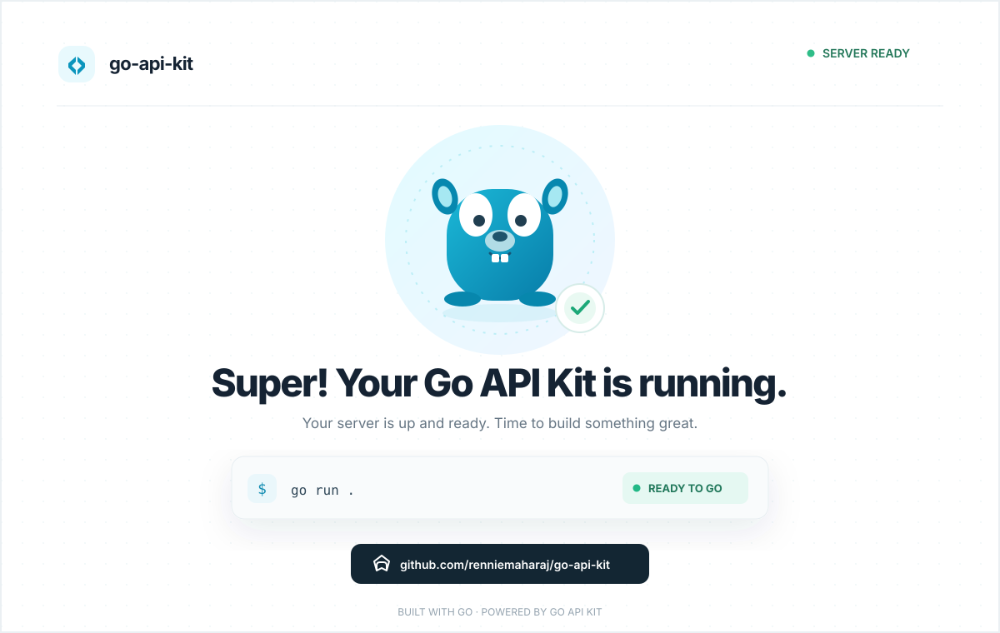

# go-api-kit

<p align="center">
	
</p>

`go-api-kit` is a small, ergonomic HTTP handler library for Go. It uses
[chi](https://github.com/go-chi/chi) internally for routing while keeping its
public API compatible with `net/http`.

<p align="center">
	
</p>

## Installation

```bash
go get github.com/renniemaharaj/go-api-kit
```

## Quick start

```go
package main

import (
	"log"

	v8 "github.com/renniemaharaj/go-api-kit/v8"
)

func main() {
	if err := v8.Run("dist", "localhost", "9100"); err != nil {
		log.Fatal(err)
	}
}
```

`*kit.Router` implements `http.Handler`. Middleware uses the standard
`func(http.Handler) http.Handler` shape:

```go
k.Use(loggingMiddleware)

k.Route("/api", func(api *kit.Router) {
	api.Route("/users", func(users *kit.Router) {
		users.Get("/", listUsers)
		users.Post("/", createUser)
		users.Get("/{id}", getUser)
	})
})
```

JSON request bodies use terminology from `encoding/json`:

```go
func createUser(h kit.Handle) {
	var input CreateUser
	if err := h.UnmarshalJSON(&input); err != nil {
		h.Error.BadRequest("invalid body")
		return
	}

	if err := h.JSON(http.StatusCreated, input); err != nil {
		h.Error.Internal("could not encode response")
	}
}
```

Common response operations stay directly on `Handle`: `JSON`, `Text`, `HTML`,
`Status`, `NoContent`, `Redirect`, `File`, and `StaticFS`. Cohesive operations
are grouped under `h.Error` and `h.Header`. `Request()` and `Writer()` expose
the underlying standard-library values whenever direct access is clearer.

`NewHandler` remains available for use with any standard-library router:

```go
mux := http.NewServeMux()
mux.HandleFunc("GET /", kit.NewHandler(func(h kit.Handle) {
	h.StaticFS(os.DirFS("dist"), "index.html")
}))
```

The `v8` package can serve a frontend directory directly. Its filesystem root
is confined to the directory passed to `Run`:

```go
if err := v8.Run("dist", "localhost", "9100"); err != nil {
	log.Fatal(err)
}
```
